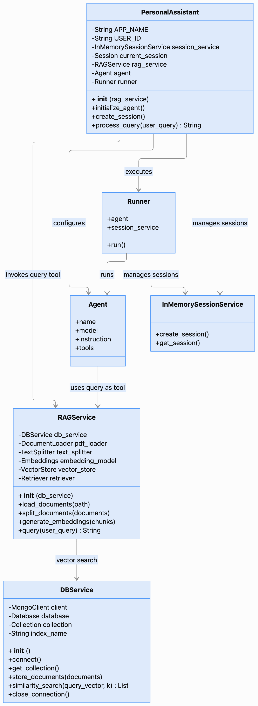
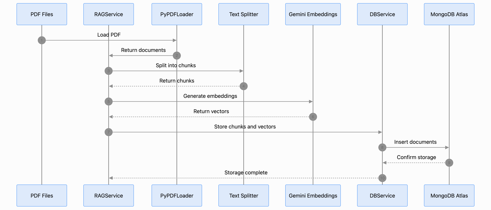
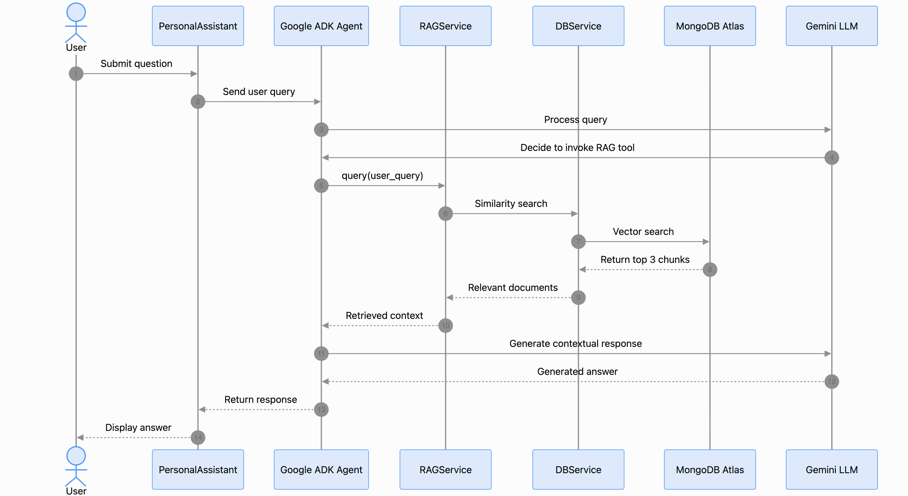

# Personal Local Assistant

A Python-based AI personal assistant built using **Google Agent Development Kit (ADK)**, **LangChain**, and **MongoDB Atlas Vector Search**.

The application uses a Retrieval-Augmented Generation (RAG) architecture to retrieve relevant information from PDF documents and provide context-aware answers through a Gemini-powered AI agent.

## Architecture

The application consists of three primary components:

1. **PersonalAssistant** – Manages AI agent initialization, conversation sessions, and user queries using Google ADK.
2. **RAGService** – Loads PDF documents, splits them into smaller chunks, generates embeddings, and retrieves relevant document content.
3. **DBService** – Manages MongoDB connections, document storage, and vector similarity searches.

### Class Diagram

The class diagram illustrates the relationships and responsibilities of the application's primary components.



### Document Ingestion Flow

PDF documents are processed separately before they can be queried.

The ingestion pipeline performs the following operations:

1. Loads PDF documents using `PyPDFLoader`.
2. Splits the extracted text into smaller chunks.
3. Generates vector embeddings using Google's embedding model.
4. Stores the embeddings and associated metadata in MongoDB Atlas.



### Query Flow

When a user submits a question, Google ADK manages the conversation and determines when to invoke the RAG service.

The query pipeline performs the following operations:

1. Receives the user's question.
2. The Gemini-powered agent determines whether the RAG tool is required.
3. The RAG service converts the question into a vector embedding.
4. MongoDB Atlas Vector Search retrieves the most relevant document chunks.
5. The retrieved context is returned to the AI agent.
6. Gemini generates a context-aware response.



## Technology Stack

| Technology | Purpose |
|---|---|
| Python | Primary programming language |
| Google ADK | AI agent orchestration and session management |
| Gemini | LLM for generating responses |
| Google Generative AI Embeddings | Converts text into vector embeddings |
| LangChain | RAG pipeline and document processing |
| MongoDB Atlas | Vector database |
| PyMongo | MongoDB database connectivity |
| PyPDF | PDF document loading |

## Project Structure

```text
personal-local-assistant/
│
├── local_agent/
│   ├── main.py
│   ├── personal_assistant.py
│   ├── rag_service.py
│   └── db_service.py
│
├── documents/
│   └── old_sage.pdf
│
├── class_diagram.png
├── ingestion_flow.png
├── query_flow.png
│
├── .env
├── .gitignore
├── requirements.txt
└── README.md
```

## Prerequisites

Before running the application, make sure you have:

- Python 3.10 or later.
- A Google AI Studio API key.
- A MongoDB Atlas account.
- A MongoDB Atlas cluster with Vector Search enabled.
- A MongoDB Vector Search index configured for your embedding dimensions.

## Installation

### 1. Clone the repository

```bash
git clone <YOUR_REPOSITORY_URL>

cd personal-local-assistant
```

### 2. Create a virtual environment

```bash
python3 -m venv venv
```

Activate the environment:

**macOS / Linux**

```bash
source venv/bin/activate
```

**Windows**

```bash
venv\Scripts\activate
```

### 3. Install dependencies

```bash
pip install -r requirements.txt
```

### 4. Configure environment variables

Create a `.env` file in the project root.

```env
GOOGLE_API_KEY=your_google_api_key

MONGO_DB_USER=your_mongodb_username
MONGO_DB_PASS=your_mongodb_password
```

Make sure your application loads these variables using `python-dotenv` or another environment-variable loading mechanism.

**Important:** Never commit your `.env` file or expose your API keys and database credentials.

## Dependencies

The project uses the following Python packages:

```text
google-adk
langchain
langchain-community
langchain-core
langchain-google-genai
langchain-mongodb
langchain-text-splitters
pymongo
pypdf
```

## MongoDB Configuration

Create a MongoDB Atlas database and collection.

The current implementation uses:

```text
Database:   local-agent
Collection: embedd-data
Index:      vector_index
```

Create a Vector Search index named `vector_index` on the collection.

The index must use the same embedding dimensions as the configured embedding model.

For the current implementation, the embedding model is:

```python
GoogleGenerativeAIEmbeddings(
    model="gemini-embedding-2-preview"
)
```

Make sure the index uses the correct vector field name and dimensions generated by the embedding model.

## How It Works

### 1. Document Embedding

The `RAGService` loads PDF documents using `PyPDFLoader`.

The documents are then split into smaller chunks using `RecursiveCharacterTextSplitter`.

Current configuration:

```python
RecursiveCharacterTextSplitter(
    chunk_size=500,
    chunk_overlap=150
)
```

Each chunk is converted into a vector embedding using Google's embedding model and stored in MongoDB Atlas.

### 2. Vector Search

When a user submits a question, the RAG service:

1. Converts the question into an embedding.
2. Performs a similarity search against MongoDB Atlas.
3. Retrieves the three most relevant document chunks.
4. Returns the retrieved content to the AI agent.

The retriever currently uses:

```python
search_type="similarity"

search_kwargs={
    "k": 3
}
```

### 3. AI Agent Response

Google ADK manages the conversation and determines when to invoke the RAG tool.

The agent receives the retrieved document content and uses it to generate a response based on the available context.

The agent is configured with:

```python
tools=[self.__rag_service.query]
```

This allows the agent to invoke the RAG service as a tool when answering questions about the knowledge base.

## Running the Application

After configuring the environment and MongoDB Atlas, run the application using:

```bash
python main.py
```

Make sure the application initializes the database service, RAG service, and personal assistant before accepting user queries.

## Future Improvements

- [ ] Support multiple PDF documents and knowledge bases.
- [ ] Implement conversation history persistence.
- [ ] Add streaming responses from the AI agent.
- [ ] Improve document retrieval with metadata filtering.
- [ ] Implement error handling and retry mechanisms for API rate limits.
- [ ] Add support for additional document formats.
- [ ] Implement a local user interface for interacting with the assistant.

## License

This project is intended for personal learning and experimentation with AI agents, RAG architectures, and vector databases.
