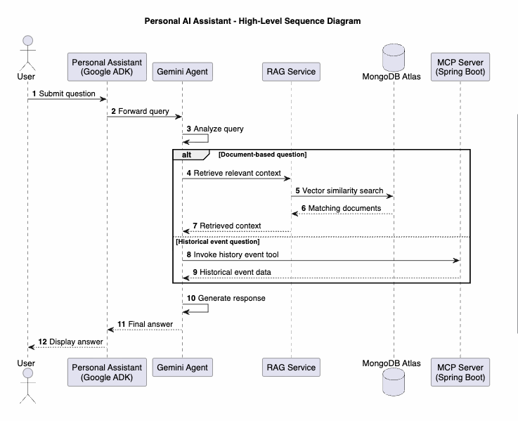

# Personal Local Assistant

A Python-based AI personal assistant built using **Google Agent Development Kit (ADK)**, **Gemini**, **LangChain**, **MongoDB Atlas Vector Search**, and **Model Context Protocol (MCP)**.

The application combines AI agent orchestration, Retrieval-Augmented Generation (RAG), and external tool integration to provide context-aware responses.

The assistant can retrieve information from PDF documents using semantic search and interact with external services through MCP tools. A Spring Boot MCP server exposes historical event data to the AI agent, demonstrating how Python-based AI applications can integrate with Java backend services.

## Architecture

The application consists of the following primary components:

1. **PersonalAssistant** – Manages AI agent initialization, conversation sessions, and user queries using Google ADK.
2. **Root Agent (Gemini)** – Understands user queries, determines which tools to invoke, and generates context-aware responses.
3. **RAGService** – Loads PDF documents, splits extracted text into smaller chunks, generates embeddings, and retrieves relevant document content.
4. **DBService** – Manages MongoDB connections, document storage, and vector similarity searches.
5. **MCP Client** – Connects the Google ADK agent to external tools using the Model Context Protocol.
6. **Spring Boot MCP Server** – Exposes historical event retrieval functionality through MCP tools using Spring AI.

### Overall Architecture and Execution Flow

The diagram illustrates the interaction between the user, AI agent, RAG subsystem, MongoDB Atlas, and Spring Boot MCP server.



## Core Features

- **AI Agent Orchestration:** Uses Google ADK and Gemini to process user queries and coordinate tool execution.
- **Retrieval-Augmented Generation (RAG):** Retrieves relevant information from PDF documents using semantic similarity search.
- **Vector Search:** Uses MongoDB Atlas Vector Search to store and retrieve document embeddings.
- **MCP Tool Integration:** Connects the AI agent to external tools through the Model Context Protocol.
- **Java and Python Integration:** Demonstrates communication between a Python AI application and a Spring Boot MCP server.
- **Session Management:** Uses Google ADK's InMemorySessionService to manage conversation sessions.

## Technology Stack

| Technology | Purpose |
|---|---|
| Python | Primary AI application language |
| Java | MCP server implementation |
| Google ADK | AI agent orchestration and session management |
| Gemini | LLM for reasoning and response generation |
| Google Generative AI Embeddings | Converts text into vector embeddings |
| LangChain | RAG pipeline and document processing |
| MongoDB Atlas | Vector database and document storage |
| PyMongo | MongoDB connectivity |
| PyPDF | PDF document loading |
| Spring Boot | Java backend application |
| Spring AI MCP | MCP server and tool integration |
| Model Context Protocol | Standardized communication between AI agents and external tools |

## Project Structure

```text
personal-local-assistant/
│
├── local_agent/
│   ├── main.py
│   ├── personal_assistant.py
│   ├── rag_service.py
│   └── db_service.py
│
├── local_agent_mcp_server/
│   └── src/
│       └── main/
│           └── java/
│               └── com/mohamed/local_agent_mcp_server/
│                   ├── providers/
│                   │   └── HistoryEventProvider.java
│                   ├── services/
│                   │   └── HistoryEventService.java
│                   └── models/
│                       └── HistoryEvent.java
│
├── documents/
│   └── old_sage.pdf
│
├── overall-flow.png
├── .env
├── .gitignore
├── requirements.txt
└── README.md
```

## Prerequisites

Before running the application, make sure you have:

- Python 3.10 or later.
- Java and a compatible JDK for the Spring Boot MCP server.
- A Google AI Studio API key.
- A MongoDB Atlas account.
- A MongoDB Atlas cluster with Vector Search enabled.
- A configured MongoDB Vector Search index.
- A running Spring Boot MCP server.

## Python Application Setup

### 1. Clone the repository

```bash
git clone <YOUR_REPOSITORY_URL>
cd personal-local-assistant
```

### 2. Create a virtual environment

```bash
python3 -m venv venv
```

Activate the environment:

**macOS / Linux**

```bash
source venv/bin/activate
```

**Windows**

```bash
venv\Scripts\activate
```

### 3. Install dependencies

```bash
pip install -r requirements.txt
```

### 4. Configure environment variables

Create a `.env` file in the project root.

```env
GOOGLE_API_KEY=your_google_api_key

MONGO_DB_USER=your_mongodb_username
MONGO_DB_PASS=your_mongodb_password
```

Make sure your application loads these variables using `python-dotenv` or another environment-variable loading mechanism.

**Important:** Never commit your `.env` file or expose your API keys and database credentials.

## MongoDB Configuration

The current implementation uses:

```text
Database:   local-agent
Collection: embedd-data
Index:      vector_index
```

Create a MongoDB Atlas Vector Search index named `vector_index` on the `embedd-data` collection.

The index must use the correct vector field name and dimensions generated by the configured embedding model.

Current embedding model:

```python
GoogleGenerativeAIEmbeddings(
    model="gemini-embedding-2-preview"
)
```

## MCP Server Configuration

The project uses a separate Spring Boot application to expose historical event retrieval functionality through MCP.

The Python application connects to the MCP server using Google's ADK `McpToolset`.

Current MCP endpoint:

```text
http://localhost:8080/mcp
```

The Spring Boot application exposes the following tool:

```text
Tool Name: history_event_tool
```

**Tool functionality:**

- Accepts a historical year as input.
- Retrieves the corresponding historical event.
- Returns a `HistoryEvent` object to the AI agent.

The current dataset covers British India historical events from 1600–1947.

Start the Spring Boot MCP server before running the Python application.

## How It Works

### 1. Document Ingestion

The `RAGService` loads PDF documents using `PyPDFLoader`.

The extracted pages are filtered and split into smaller chunks using `RecursiveCharacterTextSplitter`.

Current configuration:

```python
RecursiveCharacterTextSplitter(
    chunk_size=500,
    chunk_overlap=150
)
```

Each chunk is converted into a vector embedding using Google's embedding model and stored in MongoDB Atlas.

### 2. RAG Retrieval

When a user asks a question about the Old Sage novel:

1. Gemini identifies that the RAG tool is required.
2. The RAG service converts the question into an embedding.
3. MongoDB Atlas Vector Search performs semantic similarity search.
4. The three most relevant document chunks are retrieved.
5. The retrieved content is returned to the AI agent.

Current retriever configuration:

```python
search_type="similarity"

search_kwargs={
    "k": 3
}
```

### 3. MCP Tool Execution

When a user asks about a historical event:

1. Gemini determines that the historical event MCP tool is required.
2. Google ADK invokes the MCP tool through `McpToolset`.
3. The Spring Boot MCP server receives the request.
4. `HistoryEventProvider` delegates the request to `HistoryEventService`.
5. The service retrieves the historical event using the requested year.
6. The result is returned to the AI agent through MCP.

### 4. AI Agent Response

After receiving the relevant context from RAG or the historical event data from MCP, Gemini generates the final response.

Google ADK manages the execution lifecycle and returns the final response to the user.

## Running the Application

Start the Spring Boot MCP server first.

Then activate the Python virtual environment and run:

```bash
python main.py
```

Make sure the application initializes the following components:

1. DBService
2. RAGService
3. PersonalAssistant

The MCP server should be accessible at `http://localhost:8080/mcp` before submitting queries that require historical event retrieval.

## Future Improvements

- [ ] Support multiple PDF documents and knowledge bases.
- [ ] Implement persistent conversation history.
- [ ] Add streaming responses from the AI agent.
- [ ] Improve document retrieval with metadata filtering.
- [ ] Implement error handling and retry mechanisms for API rate limits.
- [ ] Add support for additional document formats.
- [ ] Implement a local user interface for interacting with the assistant.
- [ ] Expand MCP integration with additional external tools.

## License

This project is intended for personal learning and experimentation with AI agents, RAG architectures, vector databases, and Model Context Protocol integration.